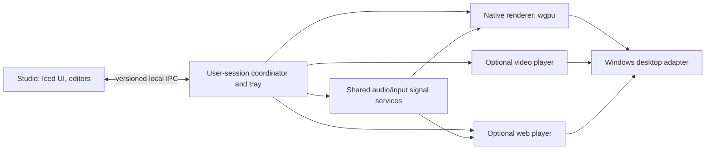

# Architecture and contributor contract

## Current implementation update

The workspace now has six working crates: `serein-domain`, `serein-audio`, `serein-render`, `serein-platform`, `serein-player` and `serein-studio`. The studio coordinates a separate native desktop player through bounded, validated session snapshots written with same-directory replacement. Status includes the process ID, session token and submitted-frame count; the studio accepts status only for its current child/session. It does not stream raw audio over JSON.

The studio owns the tray. Close/minimize hides its window and suspends studio preview/capture; the player continues. Explicit Exit stops the child. The UI process remains allocated while hidden. Splitting tray coordination into a smaller permanent host remains a later optimization, not a claim about current memory use.

Rendering, the shader ABI and images are shared by studio and player. Catalog thumbnails are generated once from the real shaders and cached as PNGs. Audio follows the default endpoint or retries a pinned endpoint automatically. Capture is not controlled by a user-facing Start/Stop action. Imported photos and per-preset profiles persist under Serein's local data directory.

## Boundaries

The diagram is the target process architecture. The current studio/player boundary is implemented; optional video/web players and a separate minimal tray coordinator remain future work. Avoid creating placeholder crates that falsely imply working services.

* `serein-domain`: serializable documents, validation, EQ settings, named response buses, geometry and pure playback policy. No UI or Win32 dependency.
* `serein-audio`: biquad filtering, windowed FFT, waveform and response envelope; bounded worker exchange and Windows capture adapter. Independent from the studio.
* `serein-studio`: views, styles, interaction state, file dialogs, shader validation/preview, monitor inspection and development tray. Does not claim to be the production host.
* `serein-render` shares the GPU pipeline, shader interface, image/depth handling and preset catalog. `serein-platform` isolates native desktop/display APIs. `serein-player` owns desktop presentation, frame timing, display layout and automatic pause behavior. Future `host`, `sdk` and `package` work extends these boundaries; web and media remain optional backends.

## Runtime decisions

Use a per-user coordinator, not a Windows service in session 0. One native renderer per GPU/display group amortizes device creation and can share immutable assets. Separate untrusted execution from the coordinator; a process boundary alone is not an OS sandbox. A crashed renderer should not terminate settings or tray. Web projects need origin/storage isolation and restricted bridges. No extension can call arbitrary host APIs.

Future IPC: version handshake, correlation IDs, bounded frames, typed commands, caller/session authentication, length limits and validation. Use named pipes scoped to the user. Raw PCM does not traverse JSON IPC each frame; share bounded snapshots or authenticated shared memory. Reject incompatible protocol versions with a useful error.

Asset decoding and shader compilation occur away from frame submission; a newly validated pipeline replaces the last-good one atomically. Naga validates WGSL structure/types. It does not prove a shader fits GPU time budgets. An execution watchdog/restart strategy is required, and Windows GPU timeouts can affect more than this process. Do not call user shaders fully sandboxed.

An event-driven scheduler observes shell/session/display/app changes. Use hysteresis when recovering from occlusion. Prefer missed-deadline skipping to work queues that build latency. Pause -> no frame submission; unload -> close decoders, signal subscriptions, textures and renderer when unused. Editor previews are not running wallpaper instances.

## Native renderer decisions to prove in player alpha

Use a small render graph to share passes and transient targets; discard disabled branches. Start with full-screen fragments and textured quads, then add a scene graph with transforms, glTF meshes, PBR materials and bounded particle/compute passes. Material instances expose typed parameters without recompiling their shader. Cache immutable textures/meshes by content hash; mipmaps, texture compression, culling and level-of-detail belong to the asset pipeline. Prebaked lighting is an explicit creator option.

Clone mode can reuse rendered output only when dimensions, camera, color space and inputs match. Otherwise share assets and shader pipelines rather than claiming one render covers every monitor. Span can render each monitor's tile with a common virtual-desktop transform, avoiding a huge intermediate texture. Each display still has presentation and bandwidth costs. Time comes from one monotonic clock; different frame ceilings do not advance simulations at different speeds.

Use winit/wgpu presentation with deadline-based scheduling, avoid a busy loop and skip missed frames. Adapter selection follows the display's GPU where possible; hybrid-GPU copies must be measured. HDR surfaces need an explicit scene-linear working space and SDR conversion path; do not just treat all targets as 8-bit sRGB.

For Windows video, evaluate Media Foundation/DXVA hardware decoding first. D3D texture sharing into the selected wgpu backend, synchronization and color conversion need a measured interop spike. Do not promise zero-copy before that test. An mpv/FFmpeg-based optional backend may broaden formats but adds distribution/licensing and footprint decisions. Native scene playback must not load that dependency path.

## Signal ABI (proposed v1)

One monotonically timestamped snapshot: elapsed/delta time; scene dimensions; pointer UV + valid state; raw RMS/peak; up to 64 logarithmic analysis bins; named normalized bus values. Fixed alignment and explicit units cross CPU/GPU/Wasm boundaries. Pointer absence is distinct from `(0,0)`. Signals declare subscriptions in the manifest. Capture and high-resolution FFT exist only if at least one subscriber needs them.

Graph nodes are typed (`float`, `vec2`, `vec3`, `color`, `event`); conversions are explicit. A graph compiles into a bounded evaluation plan, sharing common subexpressions. Reject cycles except explicit bounded state/delay nodes. Updating a property does not recompile every shader. Scripts cannot allocate unbounded per-frame data or use unrestricted filesystem/network APIs.

Wasm is the planned advanced logic runtime, with memory limits, host-call limits, fuel/epoch checks and capability-scoped imports. Rust creators can target Wasm; casual users use nodes. Do not embed rustc in the player. WGSL handles pixel/compute code. GLSL/Shadertoy conversion is a future importer, not automatic compatibility.

## Audio pipeline

Endpoint PCM -> channel handling -> analysis gain -> persistent biquad cascade -> Hann window -> FFT -> raw/filtered spectrum -> frequency-range energy -> attack/release -> normalized bus snapshot. A separate time-domain downsample provides a waveform. Sample format, sample rate and channel count are explicit, not inferred from UI labels. Channel cancellation and per-channel routing require further stereo work beyond foundation's mono analysis.

Preallocate FFT buffers/plans and filter states. UI parameter changes recompute coefficients, not FFT plans. Avoid blocking the capture thread on painting. Exchange the latest analysis frame through bounded state; drop stale visualization frames rather than increasing audio latency. On stale capture, decay buses to silence. A published screenshot must say when it uses generated test data.

Foundation may use bounded mutex snapshots for ease of review; production callback paths need measured contention/allocation tests before release. Do not describe that initial design as a proven lock-free real-time engine.

## Documents and imports

Version each project. Validate numbers for finiteness, frequency limits, sample-rate/Nyquist constraints, EQ count, gain/Q, bus range, render scale and FPS. Never overwrite an unsupported future schema. Persistence uses a same-directory temporary file and atomic replace where supported, preserves the previous project on failed validation, and applies bounded reads. A JSON design document is distinct from a distributable asset archive.

Later archive import rejects absolute paths, `..` traversal, symlinks, decompression bombs and missing/recursive dependencies. Hash assets, preserve license/author metadata, limit decoded dimensions, and prompt for actual capabilities. Keep raw project assets separate from rebuildable caches. Export pins SDK/package versions. Untrusted native DLLs/executables are not supported wallpaper packages.

## Engineering conventions

Keep business rules as pure functions and adapters narrow. Use descriptive types with units (`frequency_hz`, `gain_db`, `attack_ms`). Prefer a small module per responsibility to one giant application file. Comments explain lifecycle, assumptions and non-obvious tradeoffs; do not narrate each assignment. Every unsafe block needs its safety argument. Avoid `unwrap` on user files, devices, shaders and OS results. Surface actionable errors.

Add meaningful tests for DSP, malformed documents, topology and policy; do not test that a label equals its own constant. Use `cargo fmt`, workspace tests and Clippy. Check rendering in the actual native app. Record limitations instead of inferring visual/accessibility correctness from compilation.

## Release risk register

| Risk | Required evidence |
| --- | --- |
| Explorer integration relies on shell behavior | Windows build matrix, timed attach, restart/recovery/static fallback |
| Hybrid GPUs and mixed DPI | Physical machines, repeated dock/undock, refresh changes, negative-origin spans |
| Expensive/malicious shader | Compile failures, GPU load limits, last-good preservation, recovery tests; no safety claim from validation alone |
| Audio loopback format/device transitions | 44.1/48/96 kHz, silence, default-device switch, USB/Bluetooth disconnect, protected content |
| Key reactions and permissions | Explicit grant/revoke, no text/history, lock/session clearing, audit of host bridge |
| Native toolkit accessibility | Narrator, keyboard, high-contrast and text scaling spike before consumer release |
| Codec/asset/licensing choices | Dependency and redistribution review before shipping; research is not legal advice |
| Marketplace operations | Separate service, signing/moderation/reporting; not part of the local alpha |

